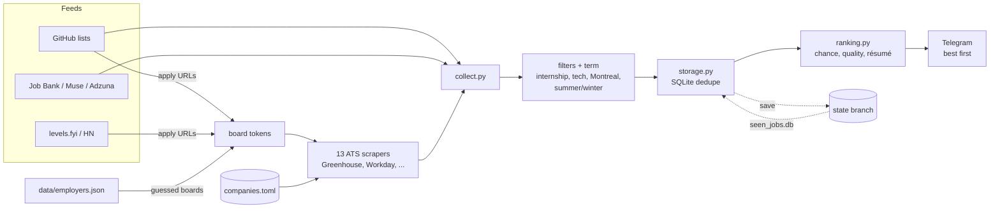

# internbot

A Telegram bot that watches for new **IT / software / cybersecurity / DevOps internships in the
Montreal area** (Summer *and* Winter terms), ranks them, tells me which résumé to send, and
messages me. It runs on a schedule in GitHub Actions, never sends the same posting twice, and
can be started on demand by messaging it a keyword.

Official or public APIs only: Adzuna, the public job-board APIs of Greenhouse, Lever, Ashby,
Workday and a dozen other applicant-tracking systems, Canada's Job Bank feed, and the Telegram
Bot API. No logins, no browser automation.

## What a message looks like

```
🆕 3 new internship postings, best match first

1. Software Developer Intern
   Shopify — Montréal, QC
   ⭐ chance 71 · quality 74 · Summer 2027 · strong-tier · matches python, sql, docker
   📄 Résumé: backend (databases, distributed systems)
   https://...

2. Cloud DevOps Intern
   ...
   📄 Résumé: devops (containers/orchestration, CI/CD)

Checked 21 sources
```

When a check finds nothing new, you still hear about it:

```
✅ internbot checked at Tue Oct 13, 14:05: no new internship postings.
Looked through 143 postings across 21 sources.
```

* **chance** (0-100): how well you fit, minus how contested the role is. It never exceeds fit.
* **quality** (0-100): how good the internship is whoever applies: pay, return-offer and mentorship
  language, real-work language, company tier.
* **Résumé**: which of your résumé variants to send, with the evidence for it. The title votes
  first; the posting body can override it only with a clear margin and more than one signal.

Neither score is calibrated against real outcomes. They rank today's postings against each other,
nothing more. Postings with no description (the curated lists carry titles only) are marked
*title only*, and their scores lean on the title and the company.

## Terms: winter and summer

Every posting is classified from its title and description (English and French: *été 2027*,
*hiver 2027*, start dates like "starting January 2027"):

| Term | Meaning | Sent? |
|---|---|---|
| `summer-2027`, `winter-2027` | names an upcoming Summer or Winter term | yes |
| `summer` / `winter` | a bare season in the title, no year | yes |
| `unstated` | says nothing about a term | yes, a human decides |
| `other-cycle` | Fall or Spring, or a past or far-future year | no |

The wanted terms are computed from today's date (a term stays open for ~75 days after it starts,
and is looked for up to ~15 months ahead), so nothing needs editing when the year changes.

## Sources

Every posting is filtered to the Montreal area (the metro's suburbs count, and so does
"Remote - Canada" when no more specific place is named), to internship-looking IT/software
titles, and to a wanted term.

**Feeds**

| Source | What it gives |
|---|---|
| Curated GitHub lists | vanshb03, speedyapply (US + international), sndsh404, resumax, zapplyjobs Canada: current postings. SimplifyJobs, the Canadian boards, zshah101 and others: mined for company boards only |
| Canada Job Bank | the government feed (Quebec, software occupation codes, plus "software intern") |
| The Muse | internships tagged Software Engineering |
| Adzuna | keyword searches around Montreal (needs `ADZUNA_APP_ID` / `ADZUNA_APP_KEY`) |
| levels.fyi, Hacker News "Who is hiring?" | mined for company boards only |
| `companies.toml` | boards I picked by hand (Greenhouse / Lever) |

**Company boards, enumerated directly.** Apply URLs in the feeds name each employer's board
(`job-boards.greenhouse.io/figureai/...` means `figureai`), and `data/employers.json` is probed
against every ATS, so employers no feed has mentioned are still found. Each board is read through
its own public API:

Greenhouse, Lever, Ashby, **Workday** (most Canadian employers, including student-only campus
portals), Oracle Fusion, SmartRecruiters, Workable, Recruitee, BambooHR, iCIMS, Eightfold,
Personio, and Phenom (sites in `data/phenom-sites.json`, e.g. Bell).

Not included: Indeed. It needs a real browser and sits behind Cloudflare, which blocks GitHub's
servers; it was switched off by default in the project this was ported from, too.

Any source can be switched off in `settings.toml` under `[sources]`.

## How it works



1. **Collect:** every source returns `Job` objects. A failing source is logged and skipped; the run
   only fails if *every* source fails.
2. **Filter:** internship title + IT/tech title + in the Montreal area + not a Fall/Spring/past term.
3. **Dedupe:** SQLite remembers what was already sent, by job ID and by (company, title) across
   different sources, so a posting listed on a company board and on Adzuna is sent once.
4. **Rank:** best chance first, then quality. Each posting gets its résumé recommendation.
5. **Notify:** every new posting is sent, `postings_per_message` (20) per message, as many messages
   as it takes. A message that would pass Telegram's 4,096-character limit spills into another.
   Postings are marked seen only after every message was delivered.

## Schedule: every slot actually runs

Set the times in `settings.toml`:

```toml
[schedule]
timezone = "America/Toronto"
weekday_hours = [6, 8, 10, 12, 14, 16, 18, 20, 22]
weekend_hours = [8, 12, 16, 20]
```

GitHub's cron is UTC-only, is routinely delayed, and sometimes drops runs entirely, so it can't be
trusted to hit exact times. Instead the workflow wakes every 15 minutes and `internbot/schedule.py`
asks: *has a slot come due that hasn't run yet?* A late run is simply run late; a slot GitHub
skipped is caught up at the next wake-up (up to `catch_up_hours` = 6 hours later); a failed run
is retried up to `max_attempts` = 3 times, with a Telegram alert each time. Daylight saving is
handled by the timezone, not by hand. The last completed slot is stored in the same `seen_jobs.db`
that holds the seen postings.

Even so, GitHub can't promise a start time: a run may begin a few minutes after its slot.

## Start a check by messaging the bot

Send the bot `check` (or `run`, `jobs`, `now`, `scan`, `refresh`, with or without a slash; change the
list under `[trigger]` in `settings.toml`). It replies "On it" and a check runs, with the results
following in a few minutes. Only messages from my own chat (`TELEGRAM_CHAT_ID`) are obeyed, and
messages older than two hours are ignored.

How: Telegram can't call GitHub directly, so `listen.yml` polls the bot every 5 minutes (GitHub's
shortest schedule) and, on a keyword, starts `daily.yml` through the GitHub API using the built-in
`GITHUB_TOKEN`. No server and no extra token are needed. The cost is a lag of up to about 5 minutes
(plus GitHub's own delay). A manual run always happens, whatever the schedule says.

## Project layout

```
internbot/
  sources/        one module per source (github, workday, greenhouse, ...); base.py = HTTP, retries,
                  parallel_map; common.py = the shared build_job gate
  collect.py      runs every enabled source
  terms.py        summer / winter / other-cycle classification
  places.py       Montreal-area matching
  scoring.py      chance + quality          lexicon.py   skills, role families, pay, company tiers
  resume.py       résumé routing             profile.py   loads profile.json
  ranking.py      best-first ordering        formatting.py  message layout
  schedule.py     "is a slot due?"           listen.py    Telegram keyword -> workflow
  filters.py  storage.py  notifier.py  config.py  main.py  heartbeat.py
settings.toml     schedule, keywords, per-run cap, source switches
companies.toml    company boards to watch + location keywords (also read by web/)
profile.json      my skills and résumé variants, used for ranking
data/             employers.json, phenom-sites.json
tests/            pytest suite
web/              the dashboard / kanban app (separate; see web/README.md)
.github/workflows/  daily.yml (checks), listen.yml (keyword), weekly.yml (check-in + keepalive)
```

## Setup

### 1. Accounts and keys
- **Telegram:** message `@BotFather`, run `/newbot`, keep the token. Send your bot any message,
  then run `python -m internbot.notifier --get-chat-id` to find your chat ID.
- **Adzuna:** register at <https://developer.adzuna.com> for a free app ID and key.

### 2. Make `profile.json` mine
The ranking is only as good as this file. List the skills I really have (keys from
`internbot/lexicon.py`), the role families I prefer in order, and the résumé variants I actually
have: `fullstack`, `backend`, `ai`, `ios`, `security`. A variant not listed falls
back to the closest one I do have, ending at `fullstack`.

### 3. Run locally
```bash
python3 -m venv .venv && .venv/bin/pip install -r requirements.txt
cp .env.example .env        # fill in the four values; .env is gitignored
.venv/bin/python -m internbot.notifier        # sends "hello" to check Telegram
.venv/bin/python -m internbot.main --dry-run  # prints what it would send
.venv/bin/python -m internbot.main            # sends and records what it sent
.venv/bin/python -m pytest
```

| Variable | Purpose |
|---|---|
| `TELEGRAM_BOT_TOKEN`, `TELEGRAM_CHAT_ID` | where to send |
| `ADZUNA_APP_ID`, `ADZUNA_APP_KEY` | Adzuna API |
| `INTERNBOT_DB` (optional) | SQLite path, default `seen_jobs.db` |
| `INTERNBOT_CONFIG`, `INTERNBOT_SETTINGS`, `INTERNBOT_PROFILE` (optional) | alternative config files |

A full run reads a few thousand public company boards and takes several minutes.

### 4. Deploy on GitHub Actions
1. Push this repo to GitHub (public, so scheduled runs are free).
2. Add the four secrets above under *Settings → Secrets and variables → Actions*.
3. Run the **internbot** workflow once manually (*Actions → Run workflow*) to verify. The first
   run finds a large backlog; the best 25 arrive now and the rest over the next checks.

**Persistence:** runners have no disk between runs, so the workflow restores `seen_jobs.db` from
an orphan `state` branch and force-pushes it back (as a single commit) when it changed. The DB holds
only job IDs, titles, URLs and the schedule bookkeeping; the repo is public, so never put secrets in it.

**Weekly check-in and keepalive:** `weekly.yml` runs Mondays at 09:xx Toronto time. It sends a
short Telegram message, so **no message on Monday means something broke**. GitHub pauses scheduled
workflows on a public repo after 60 days without repository activity, so the same job re-enables all
three schedules through the API and pushes a fresh commit to the `state` branch to reset that clock.
That is best-effort; if you ever get GitHub's "scheduled workflows disabled" email, re-enable them
from the Actions tab.

## Adding companies

Edit `companies.toml`:

```toml
[[company]]
name = "Example Inc"
ats = "greenhouse"        # or "lever"
slug = "example"          # boards.greenhouse.io/<slug> or jobs.lever.co/<slug>
```

Most companies don't need an entry any more: if any feed links to their board, or they are in
`data/employers.json`, they are found automatically.

## Credits

The multi-source scraping, term classifier, scoring model and résumé router are ported from
[ryan-helou/Jobify](https://github.com/ryan-helou/Jobify) (which has no license file), rewritten in
Python and extended for winter terms, IT/cyber/DevOps roles and Telegram.

## Local dashboard

```bash
python -m internbot.site
```

Opens http://127.0.0.1:8765 with every posting the bot has sent, tagged by location (Montréal / Remote Canada /
Other), which CV to use and the role family, with Applied / Skip buttons and a "My stats" tab (applications per week,
by role, CV, location and company). The page refreshes from the bot's `state` branch every 5 minutes, or press
Refresh. Your marks live only in `local/applications.db`; "Export to Excel" downloads them as CSV. Postings appear
after the first bot run that includes this feature.
